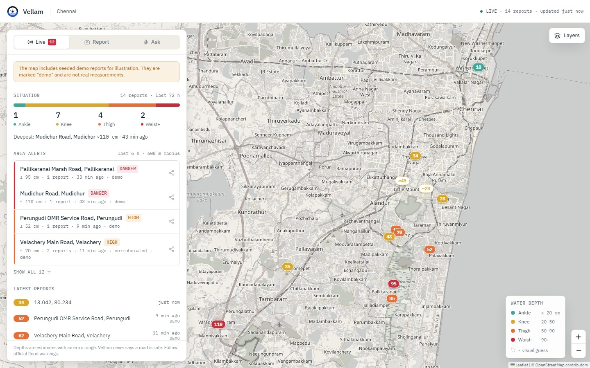
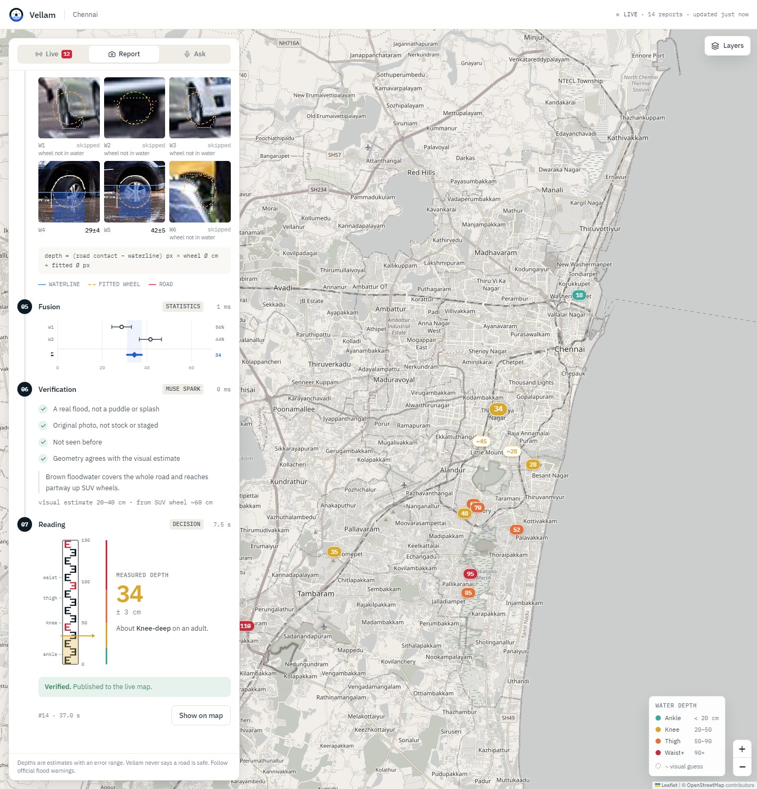
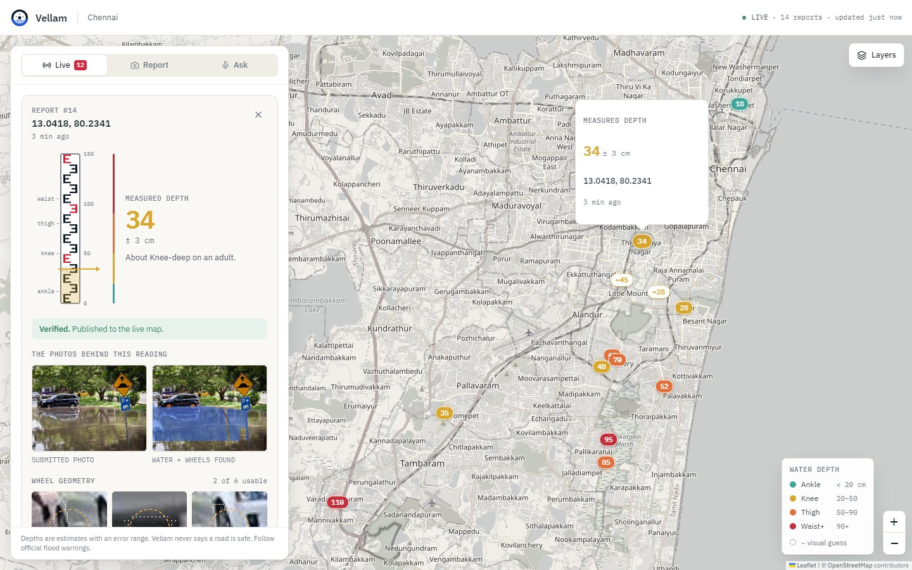
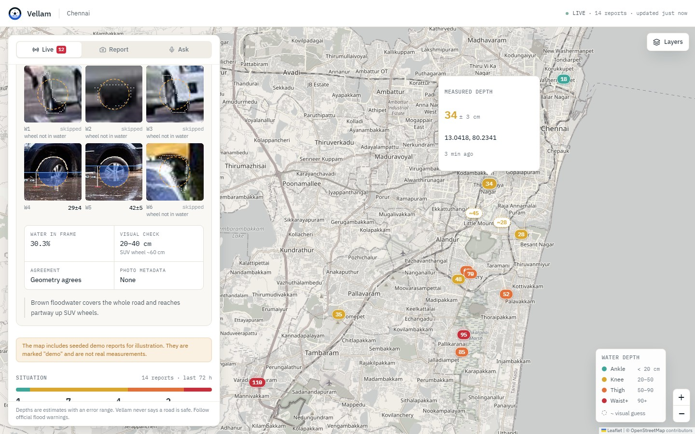
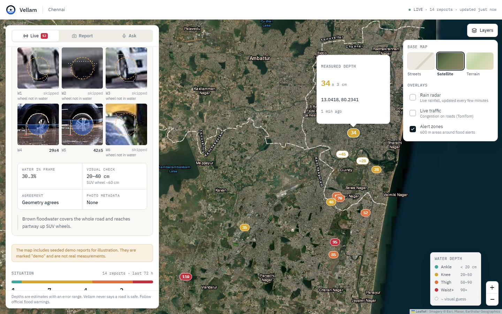
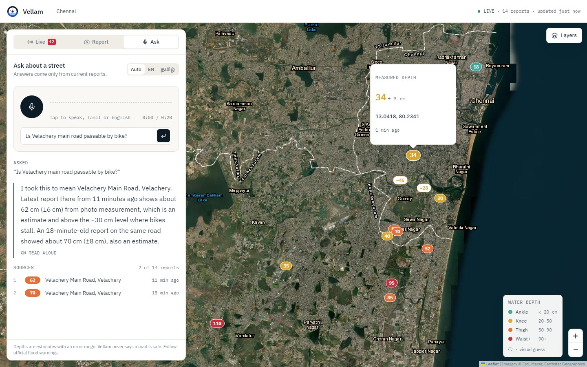
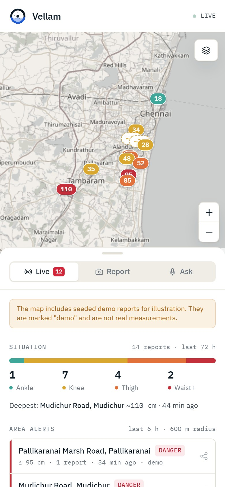
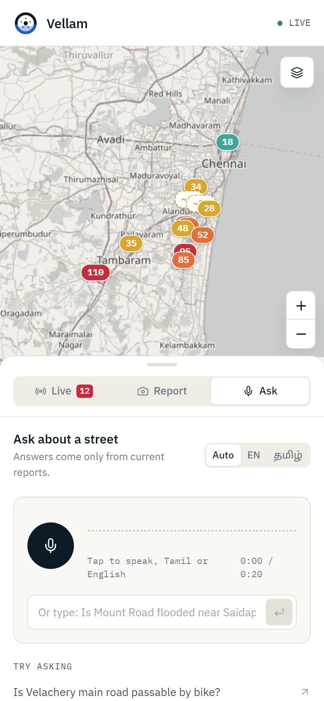
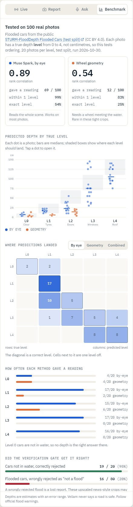

<p align="center">
  
</p>

<h1 align="center">Vellam Map</h1>

<p align="center">
  <strong>A flood early-warning system for Chennai, built from photos people already take.<br />Report, verify, measure, map, alert, and ask by voice in Tamil or English.</strong>
</p>

<p align="center">
  <a href="https://github.com/Itz-mehanth/vellam-map/actions/workflows/ci.yml"></a>
  
  
  
</p>



*Vellam* (வெள்ளம்) is Tamil for flood. This is a flood-reporting app built for Chennai, where people already
share flood photos on WhatsApp but nobody can tell from a photo whether a road is 10 cm or 1 m under water.
Vellam turns the photo into a number, checks that it is real, puts it on a live map, and warns the people nearby.

It is a system, not a single model call. Four models do four different jobs and check each other:
**SAM 3.1** segments the water and wheels, **geometry** turns that into centimetres, **Muse Spark** judges whether
the photo is a real flood and gives an independent depth estimate (a large disagreement sends the report to
review instead of the map), and **Muse Voice Transcribe** with Muse Spark answers Tamil and English questions
about the live data. Around them sit duplicate, stale and location checks, face and number-plate blurring,
area-level alert clustering, and a public-data benchmark that found, and fixed, real problems.

All of the code in this repository was written during the hackathon (first commit 28 October 2026).

Built for the **Meta Global AI Developer Hackathon** (Indie Developer track, *Build for Your World*) with
**SAM 3.1**, **Muse Spark** and **Muse Voice Transcribe** through the Meta Model API.

> **Run it yourself.** There is no hosted instance, because every report and question spends credits on the
> API key the server holds. Clone it, add your own Meta API key, and it runs on your machine in about five
> minutes: [Quick start](#quick-start).
>
> **No key? Try replay mode.** Start the backend with `REPLAY=1` (no key needed). Each test photo in the Report
> tab then plays back the pipeline run recorded on it with the real models, and the Benchmark tab replays the
> 100-photo run. Your own photos and the voice assistant need a key.

---

## Contents

[The problem](#the-problem) · [What it does](#what-it-does) · [How depth is measured](#how-depth-is-measured) ·
[Quick start](#quick-start) · [Architecture](#architecture) · [Trust and safety](#trust-and-safety) ·
[Accuracy and limits](#accuracy-and-limits) · [Testing](#testing-and-quality) · [Configuration](#configuration) ·
[Repository layout](#repository-layout) · [Credits](#credits-and-licences)

## The problem

- **1.81 billion people** (23% of the world) face serious flood risk, and 89% of them live in low- and
  middle-income countries ([World Bank](https://blogs.worldbank.org/en/climatechange/flood-risk-already-affects-181-billion-people-climate-change-and-unplanned)).
- In Chennai, about 290 people died in the 2015 floods and 17 in Cyclone Michaung (2023), many from
  electrocution and wall collapse in waterlogged streets.
- During a flood, the question that matters is *how deep is this street right now*. People post photos, but a
  photo is not data: a driver or a rescue team cannot tell what depth it shows.
- Research shows depth can be read from photos using objects of known size
  (for example FloodVision, 2025). No public tool does it. This is one.

## What it does

**1. Measure.** Upload or take a photo. SAM 3.1 outlines the water and every vehicle wheel; geometry turns the
waterline on a wheel into centimetres. The whole pipeline streams to the screen stage by stage, with the real
intermediate results, so you can see exactly why it said what it said.



*An example run on a Wikimedia Commons photo. The 34 ± 3 cm shown is the pipeline's output; the true depth of
that photo is not known, so it illustrates the interface, not accuracy.*

**2. Verify.** Muse Spark checks that it is a real flood (not a puddle, a splash or a stock photo), gives an
independent by-eye depth range, and the two are cross-checked. Duplicate photos are caught by perceptual hash,
and photo metadata is checked for age and location. A disagreement sends the report to review instead of the map.

**3. Show the evidence.** Every reading on the map opens with the photos that produced it: the submitted photo
beside the SAM analysis, a zoom on each wheel with the fitted circle and waterline, and the checks that passed
or failed. Faces and number plates are blurred before anything is stored.





**4. Map and alert.** Reports appear as depth-number pins colour-coded Ankle / Knee / Thigh / Waist+. Nearby
reports are grouped into area alerts you can share to WhatsApp. Base maps: streets, satellite, terrain.
Overlays: live rain radar, live traffic (with your own TomTom key), alert zones.



**5. Ask, by voice.** Ask in Tamil or English: *"Is Velachery main road passable by bike?"* Muse Voice
Transcribe turns speech into text; Muse Spark answers from the live reports only, in the language you asked in,
with the sources it used. It never says a road is safe.



It also works on a phone, and installs to the home screen:

<p>
  
  &nbsp;&nbsp;
  
</p>

## How depth is measured

A wheel is a circle of known size. SAM 3.1 gives the **visible** rim above the water and the water surface. A
circle fitted to the visible rim recovers the whole wheel, including the hidden lower part, so the distance
from where the wheel meets the road up to the waterline is the depth:

```
depth_cm = (wheel_bottom_y − waterline_y) × (wheel_diameter_cm / wheel_diameter_px)
```

- Real wheel sizes, with min/max ranges per vehicle class, are in [`data/reference_objects.json`](data/reference_objects.json).
- Each wheel gives an estimate with an uncertainty (wheel-size spread plus about 3 px of waterline error).
  Estimates are fused by inverse-variance weighting.
- A wheel is skipped, with the reason shown, when the water does not touch it, too little rim is visible, or the
  circle fit is implausible.
- When no wheel can be measured, the report falls back to Muse Spark's by-eye range, always labelled
  **visual guess** and drawn dashed on the map.

The implementation is [`backend/services/depth.py`](backend/services/depth.py) (the maths) and
[`backend/services/pipeline.py`](backend/services/pipeline.py) (the stages).

## Quick start

You need **Python 3.12**, **Node 20+**, and a **Meta Model API key** from <https://dev.meta.ai/api-keys/>.
Your key stays in `backend/.env` on your machine; it is git-ignored and is never sent to the browser.

```bash
git clone https://github.com/Itz-mehanth/vellam-map.git
cd vellam-map

# 1. Backend
cd backend
python -m venv .venv
source .venv/bin/activate          # Windows: .venv\Scripts\activate
pip install -r requirements.txt
cp .env.example .env               # Windows: copy .env.example .env
#   open .env and set META_API_KEY=...
python ../eval/smoke_test.py ../frontend/public/samples/s05.jpg   # optional: checks your key works
python seed_demo.py                # optional: labelled demo reports so the map is not empty
uvicorn main:app --reload          # http://localhost:8000

# 2. Frontend (in a second terminal)
cd frontend
npm install
npm run dev                        # http://localhost:5173, proxies /api to :8000
```

Open <http://localhost:5173>.

- **See it work without taking a photo:** Report tab → pick one of the 19 test photos. The Brisbane car
  (`Car stuck, Brisbane`) has two wheels at the waterline and gives a real geometric reading.
- **Ask by voice:** allow microphone access. Reading answers aloud needs a voice for the language installed on
  your device; Tamil needs a Tamil text-to-speech voice (on Windows: Settings → Time & language → Speech).
- **Live traffic (optional):** put a free [TomTom](https://developer.tomtom.com) key in `frontend/.env.local` as
  `VITE_TOMTOM_KEY=...`. Without it the traffic toggle is disabled.
- A measurement takes **25 to 70 seconds**, nearly all of it waiting on the Meta API.

Hosting it publicly is optional and best done with care for your key; see [docs/DEPLOY.md](docs/DEPLOY.md).

## Architecture

```
┌───────────────────────────────────┐
│ Frontend: React + Vite + Tailwind │  Live map and alerts · Report (live pipeline) · Ask (voice)
│ Leaflet · TanStack Query · PWA    │
└─────────────────┬─────────────────┘
                  │ REST, NDJSON stream
┌─────────────────▼─────────────────┐
│ Backend: FastAPI                  │
│                                   │
│ intake ─► SAM water ─► SAM wheels ─► circle fit ─► fusion ─► decision ─► store
│   │                                                    ▲
│   └─────────► Muse Spark verification (parallel) ──────┘     faces and plates blurred
│                                                              before images are kept
│ /api/ask: Voice Transcribe ─► Muse Spark agent (live reports as its only context)
└─────────────────┬─────────────────┘
┌─────────────────▼─────────────────┐
│ SQLite (reports) + media folder   │
└───────────────────────────────────┘
```

| Endpoint | Purpose |
|---|---|
| `POST /api/reports/stream` | Photo and location in; one newline-delimited JSON event per pipeline stage out |
| `GET /api/map` | Published reports as GeoJSON |
| `GET /api/alerts` | Clustered area alerts |
| `GET /api/reports/{id}/evidence` | The data behind a reading (wheel geometry, checks) |
| `GET /api/reports/{id}/photo.jpg`, `overlay.jpg` | Evidence images, faces and plates blurred |
| `POST /api/ask` | A spoken (WAV) or typed question in, a grounded answer out |
| `GET /api/health` | Liveness and database check |
| `DELETE /api/reports/{id}` | Moderation; disabled unless `ADMIN_TOKEN` is set |

## Trust and safety

- **Never "safe".** The app and its Q&A agent show estimated depth, uncertainty and age, and never say a road is
  safe. Estimates carry error bars; guesses and review cases are labelled, not hidden.
- **Verification before the map.** Flood evidence graded clear, possible or none (only "none" is rejected;
  "possible" is shown as unconfirmed), original photo, not a duplicate, taken in the last three days, taken near
  where it was reported, and geometry agreeing with the visual estimate. Missing metadata counts as unknown,
  never as a failure.
- **Privacy.** SAM 3.1 finds faces and licence plates and they are blurred before any image is stored. If that
  detection fails, no image is kept. Only published reports serve images. Blurring depends on SAM finding every
  face and plate, so small or partly hidden ones can be missed.
- **Abuse limits.** Upload size and pixel caps, per-client rate limits on reports and questions, input
  validation, and reports that expire from the map after 72 hours.
- **Grounded answers.** The agent sees only recent reports and says so when it has none for a place.

## Accuracy and limits

**Centimetre accuracy has not been measured yet.** That needs photos with tape-measured depths; the test is
ready ([`eval/accuracy.py`](eval/accuracy.py), bar: 15 cm mean error).

What we do have is a benchmark on **100 real photos from a public dataset** of flooded cars with ground-truth
depth *levels* (five ordered levels, not centimetres; full write-up in [docs/BENCHMARK.md](docs/BENCHMARK.md)):

| | Muse Spark by-eye estimate | Wheel geometry |
|---|---|---|
| Photos with a reading | 69 of 100 | 12 of 100 |
| Rank correlation with true level | **0.89** | 0.54 |
| Within one level of truth | **99%** | 83% |



So on this data the by-eye estimate ranks depth well and the wheel geometry is **not yet reliable**: it read only
12 photos and reads low. The first verification gate also wrongly rejected 16 of 80 real floods (20%); it now grades
its evidence instead of forcing yes or no, which cut that to 1 of 70 on photos it was never tuned on (33% before),
at the cost of flagging about a third of real floods as "unconfirmed" ([details](docs/BENCHMARK.md)). The same benchmark found and fixed a bug (impossible 2 to 6 m readings from a bad
circle fit). Caveats: 100 photos, one sample, and the dataset's cropped, upscaled car images give geometry less
to work with than a phone photo would. The depth maths is also validated on synthetic wheels (recovered within
0.5 cm), which does not validate SAM's masks on real photos. The two estimates are cross-checked, and
disagreements go to review.

The app's **Benchmark** tab shows all of this and lets you open any photo and replay its recorded pipeline,
intermediate images included, without an API call. Create its data with
`python -u eval/benchmark_flooded_cars.py --per-level 20` (faces and plates are blurred before images are saved).

Known limits:

- **Geometry needs a wheel partly under water** with the waterline crossing the tyre. Many flood photos have
  wheels fully hidden (it read 12 of 100 benchmark photos); those get only a visual guess.
- **Spray and reflections can fool the waterline.** The cross-check against the visual range catches large
  disagreements, not every error.
- **Speech-to-text garbles place names.** The agent matches them to known places and says which one it assumed.
- **Slow.** 25 to 70 seconds per report, dominated by API latency.
- **Chennai-first.** Reference wheel sizes and demo data are Chennai-flavoured, though nothing is hard-coded to
  one city.

## Testing and quality

```bash
cd backend && pip install -r requirements-dev.txt
ruff check .                # lint
python -m pytest -q         # 33 tests; no network or API key needed
cd ../frontend && npm run lint && npm run build
```

Tests cover the depth maths on synthetic wheels, fusion, the decision rules, EXIF checks, rate limiting, alert
clustering, face and plate redaction, and the evidence endpoints. CI runs all of the above on every push.

## Configuration

Backend (`backend/.env`):

| Variable | Default | Purpose |
|---|---|---|
| `META_API_KEY` | none | **Required.** Your Meta Model API key |
| `META_API_BASE_URL` | `https://api.meta.ai/v1` | API endpoint |
| `SAM_MODEL`, `MUSE_SPARK_MODEL`, `VOICE_TRANSCRIBE_MODEL` | `sam-3.1`, `muse-spark-1.3`, `muse-voice-transcribe-1.0` | Model IDs |
| `DB_PATH` | `backend/vellam.db` | SQLite file; images are stored in a `media/` folder beside it |
| `CORS_ORIGINS` | `http://localhost:5173` | Comma-separated allowed origins |
| `MAX_UPLOAD_MB`, `REPORTS_PER_HOUR`, `ASKS_PER_HOUR` | `12`, `20`, `60` | Abuse limits |
| `MAP_MAX_AGE_HOURS` | `72` | How long reports stay on the map |
| `ADMIN_TOKEN` | unset | Enables `DELETE /api/reports/{id}` |
| `SEED_DEMO` | unset | Fill an empty database with labelled demo reports at startup |

Frontend (`frontend/.env.local`, all optional): `VITE_API_BASE` (API address when not proxied),
`VITE_TOMTOM_KEY` (live traffic), `VITE_SITE_URL` (address used in link-preview tags).

## Repository layout

```
backend/
  main.py             routes, rate limits, startup
  seed_demo.py        labelled demo reports
  services/
    pipeline.py       the streamed stages: masks, geometry, fusion, decision
    depth.py          circle fit, depth, uncertainty, fusion
    meta_client.py    SAM 3.1, Muse Spark, Voice Transcribe
    verify.py         duplicate hash and Muse Spark flood check
    exif.py           photo age and location checks
    agent.py          grounded Q&A
    alerts.py         clustering into area alerts
    geo.py            reverse geocoding and distances
    limits.py         upload and rate limits
    store.py          SQLite and evidence images
  tests/              33 tests
frontend/
  src/components/     LivePanel, ReportPanel, SurveyLog, ReportDetail, AskPanel, MapStage, LayerControl
  src/lib/            depth bands, status text, layers, location
  public/             logo and icons, link-preview card, manifest, 19 sample photos
data/reference_objects.json   real-world wheel sizes
eval/                 accuracy test and tools (see eval/README.md)
docs/                 PLAN.md, DESIGN.md, DEPLOY.md, screenshots
```

Design decisions are in [docs/DESIGN.md](docs/DESIGN.md); the plan and what was cut are in
[docs/PLAN.md](docs/PLAN.md).

## Credits and licences

- Code: [MIT](LICENSE).
- **Sample photos** are from Wikimedia Commons under their own licences (public domain, CC0, CC BY, CC BY-SA);
  author, licence and source for each are in
  [`frontend/public/samples/samples.json`](frontend/public/samples/samples.json) and shown in the app.
- **Maps:** &copy; [OpenStreetMap](https://www.openstreetmap.org/copyright) contributors; satellite imagery
  &copy; Esri, Maxar, Earthstar Geographics; terrain by [OpenTopoMap](https://opentopomap.org); rain radar by
  [RainViewer](https://www.rainviewer.com); traffic by [TomTom](https://www.tomtom.com); place names by
  [Nominatim](https://nominatim.org).
- **Fonts:** IBM Plex Sans and Mono, Noto Sans Tamil (SIL Open Font Licence).
- **Models:** SAM 3.1, Muse Spark and Muse Voice Transcribe from Meta.

---

*Depth estimates are approximate. Always follow official flood warnings.*
